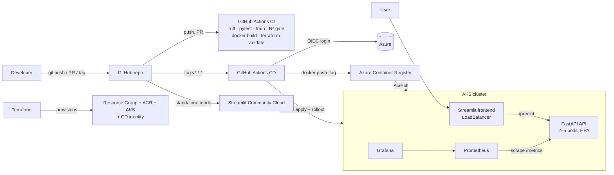

# Bengaluru House Price Prediction — MLOps

[](https://github.com/DSV-1306/bengaluru-house-price-mlops/actions/workflows/ci.yml)
[](https://github.com/DSV-1306/bengaluru-house-price-mlops/actions/workflows/cd.yml)

Predicts house prices in Bengaluru (in ₹ lakhs) from **location, total sqft, bathrooms and BHK**, trained on
13,320 listings (`data/raw/Bengaluru_House.csv`). The original Jupyter notebook was turned into a
production-style MLOps project: tested Python package → FastAPI service → Streamlit UI → Docker →
Kubernetes (minikube + Azure AKS) → Terraform → GitHub Actions CI/CD → Prometheus + Grafana monitoring.

**Step-by-step instructions with screenshots: [docs/RUNBOOK.md](docs/RUNBOOK.md)**

## Live links

| What | URL |
|---|---|
| Streamlit Community Cloud (standalone) | STREAMLIT_CLOUD_URL |
| Azure AKS (LoadBalancer) | http://AKS_EXTERNAL_IP |
| GitHub repository | https://github.com/DSV-1306/bengaluru-house-price-mlops |

## Architecture



More detail: [docs/architecture.md](docs/architecture.md).

## Model

Fixes made to the notebook: syntax error in `remove_BHK_outliers`, `predict_price` crash on unknown
locations, negative predictions (53 in the training set before → 0 now), `SettingWithCopyWarning`, a single
model → 6 compared, reproducible pipeline.

Target = `log1p(price)` with `log1p(total_sqft)` (a log-log model), predictions inverted with `expm1` and
clipped ≥ 0. GridSearchCV with `ShuffleSplit(n_splits=5, test_size=0.2, random_state=0)`, best by CV R²:

| Model | CV R² | Test R² | MAE (lakhs) | RMSE (lakhs) |
|---|---|---|---|---|
| **Ridge (α = 0.1)** ✅ | **0.8369** | **0.8452** | **13.89** | **27.99** |
| LinearRegression | 0.8365 | 0.8451 | 13.91 | 28.00 |
| Lasso | 0.8318 | 0.8403 | 14.17 | 28.43 |
| GradientBoosting | 0.8053 | 0.8421 | 15.64 | 28.27 |
| RandomForest | 0.8022 | 0.8143 | 16.51 | 30.66 |
| DecisionTree | 0.6975 | 0.7462 | 18.31 | 35.84 |

## Project structure

```
data/raw/                 dataset
notebooks/                fixed notebook (runs top to bottom, 0 errors / warnings)
src/                      config, data_processing, train, predict
api/main.py               FastAPI: /predict /locations /health /model-info /metrics
frontend/app.py           Streamlit UI (API mode or standalone mode)
tests/                    pytest: cleaning, prediction safety, R² gate, API, frontend
docker/                   Dockerfile.api (multi-stage, non-root, HEALTHCHECK), Dockerfile.frontend
docker-compose.yml        api + frontend + prometheus + grafana
k8s/base, k8s/overlays/   Kustomize: namespace, configmap, deployments, services, HPA; local + aks overlays
k8s/monitoring/           ServiceMonitor for kube-prometheus-stack
monitoring/               prometheus.yml, Grafana provisioning + dashboard, Helm values
infra/terraform/          Azure RG, ACR, AKS, AcrPull role, GitHub OIDC identity
.github/workflows/        ci.yml, cd.yml
scripts/                  load_test.py, save-screenshot.ps1, build_dashboard.py, check_notebook.py
docs/                     RUNBOOK.md, SCREENSHOTS.md, architecture.md, screenshots/
```

## Run locally

```powershell
py -3.11 -m venv .venv
.\.venv\Scripts\Activate.ps1
pip install -r requirements-dev.txt
python -m src.train                      # compare 6 models, save models/ (≈4 min; --quick ≈20 s)
pytest -v --cov=src --cov=api            # 31 tests
uvicorn api.main:app --host 127.0.0.1 --port 8000
$env:API_URL = "http://127.0.0.1:8000"; streamlit run frontend/app.py
```

## Docker

```powershell
docker compose up -d --build
```
API http://localhost:8000/docs · UI http://localhost:8501 · Prometheus http://localhost:9090 · Grafana http://localhost:3000

## Kubernetes

```powershell
kubectl apply -k k8s/overlays/local      # minikube (after minikube image load)
```
AKS: `kubectl kustomize k8s/overlays/aks` with `ACR_LOGIN_SERVER` / `IMAGE_TAG` filled in — done by CD.

## CI/CD

* **CI** (`ci.yml`, push/PR to `main`/`dev`): ruff → pytest + coverage → train → upload `metrics.json` →
  **quality gate: fail if test R² < 0.80** → build both Docker images → `terraform fmt -check` + `validate`.
* **CD** (`cd.yml`, tag `v*.*.*` or manual): Azure login via **OIDC** (no stored password) → build & push
  images to ACR tagged with the git tag and `latest` → deploy the AKS overlay → `rollout status` →
  smoke test `/health` (expects the new version) → automatic `rollout undo` on failure.

**Versioning:** the git tag (e.g. `v1.1.0`) is the single version: Docker image tag = `v1.1.0`,
`MODEL_VERSION=1.1.0` is written into `models/metrics.json`, shown by `/model-info` and the Streamlit sidebar.

## Monitoring

Custom metrics: `predictions_total{location}`, `prediction_latency_seconds`, `predicted_price_lakhs`,
`prediction_errors_total`, plus HTTP metrics from `prometheus-fastapi-instrumentator`.
Dashboard `monitoring/grafana/dashboards/house-price.json`: request rate, p50/p95 latency, error rate, total
predictions, top-10 locations, price distribution, CPU/memory per pod, replica count.

## Screenshots

See [docs/SCREENSHOTS.md](docs/SCREENSHOTS.md) — every screenshot, which phase, and what it proves.

## Teardown (avoid Azure charges)

```powershell
terraform -chdir=infra/terraform destroy
minikube delete
docker compose down -v
```
